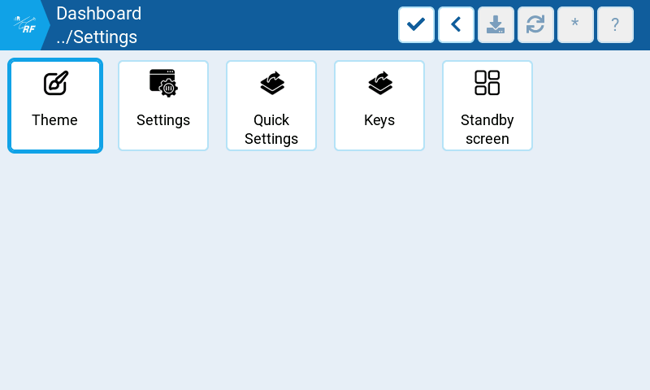
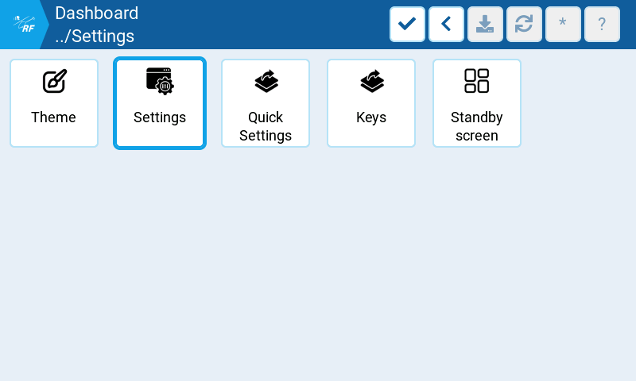

# NovaFly theme for the Rotorflight dashboard (EdgeTX, TX16S)

English | [Deutsch](rfsuite_theme_novafly/README.de.md) | [Español](rfsuite_theme_novafly/README.es.md) | [Français](rfsuite_theme_novafly/README.fr.md) | [Italiano](rfsuite_theme_novafly/README.it.md) | [Nederlands](rfsuite_theme_novafly/README.nl.md)

The NovaFly cockpit as a theme for the dashboard of the Rotorflight Suite for EdgeTX (RFSuite), and one screen behind
it: BANK, to read, set and save the headspeed of the bank you are flying.

## What you need

- RadioMaster TX16S MK3 with EdgeTX 2.12.5 (the theme is drawn for 800 x 480)
- RFSuite 0.2.2 on the SD card

## Install

1. Take the ZIP from the folder `rfsuite_theme_novafly` of this repository and unzip it. Copy the folder `novafly` to
   the SD card of the radio:

   `SCRIPTS/RFSUITE/user/dashboard/novafly/`

2. Restart the radio.

3. Press **SYS** and start **RFSuite** under Apps.

   

4. Open **Settings**.

   

5. Open **Dashboard**.

   

6. Open **Theme**.

   

7. At **Theme**, choose **NovaFly**. Save with the save symbol at the top.

   

8. Go back to **Dashboard** and open **Settings**.

   

   NovaFly has its own tile here. Open **NovaFly**.

   

   At **Colour**, choose the colour of the cockpit. Save with the save symbol at the top and confirm with **Yes**.

   

9. Put the widget RFSuite on a screen. If it is already on one of your screens, skip this step.
   Press **TELE**: the screen settings open. Press **+** at the top, then **Add Screen**.

   

   At **Layout**, choose **App mode**.

   

   Press **Setup widgets** and press the empty field. Choose **RFSuite**.

   

Go back to the screen with the RFSuite widget. This is the cockpit on the ground:

Hold your finger on the screen: the cockpit goes to full screen. It looks the same, but only in full screen does it
take presses. A long press on **RTN** leaves full screen.

## The cockpit

It is a display. All values come from the RFSuite telemetry, nothing in RFSuite is changed.

Headspeed on the dial, pack voltage and charge, BEC voltage, radio battery, current, ESC and MCU temperature, RT load,
link (RSSI and VFR), armed or disarmed, active bank and rate, flight timer and model name.

- **Flight timer.** The large clock is the flight time of RFSuite. It counts while the model is armed; after
  disarming, the time of the last flight stays. The three rows below it are the further clocks of NovaFly; the theme
  does not fill them.
- **Battery.** The percentage is calculated from the cell voltage: 3.5 V per cell is 0 %, 4.2 V is 100 %.
- **RT.** The real-time load of the FC. If the FC does not send it, CPU with the CPU load stands there.
- **VFR.** With ELRS, the link quality (RQly) stands behind VFR.

Three things you can do on the cockpit in full screen:

- **Colour.** On the ground, hold the header at the top in the middle. Each hold switches with a beep to the next of
  ten colours. The colour is remembered per model.
- **Quick menu.** A press on the field with the arm state opens the quick menu of RFSuite.
- **BANK.** A press on the field **BANK | RATE** opens the screen BANK.

## BANK

Press the field **BANK | RATE** on the cockpit. BANK reads the bank the FC is on.

The number is the headspeed of that bank. Depending on the governor mode of the FC it is the headspeed in rpm or the
max throttle in %. While the rotor turns, the active bank shows the headspeed of this moment. The theme does not fill
the two rows below (- and +). The other banks say NOT READ until you switch to them with the bank switch on the
radio.

Press the active bank. Minus and plus appear beside the number.

Each press changes the value by one step (10 rpm for the headspeed). A changed value is yellow, and SAVE turns
green.

Press **SAVE**. The theme writes the governor profile of that bank through RFSuite, reads it back and compares
it, writes it to the EEPROM and reads it once more. Four green fields and a beep mean: saved and checked.

What BANK does not do:

- It does not read or write while the model is armed. It says "Model is armed. Disarm first." and nothing goes out.
- It does not write when the arm state is unknown.
- It does not call a value saved that the FC took differently. The old profile goes back and the screen says
  "Read-back differs. NOT confirmed as saved."

**BACK** or the **RTN** key closes BANK and the cockpit is there again. If the link to the heli is lost, BANK closes
by itself.

## Notes

- **Change of flight phase.** RFSuite rebuilds the screen at every change of flight phase: when the governor becomes
  active or the throttle rises above 35 %, when you disarm after the flight, and when you arm again after that. The
  screen is black for about one second while it does. BANK keeps what it has read.
- **Throttle on the radio.** The theme changes nothing on your radio. If you fly with the governor in the FC, the
  throttle on the radio must be fixed in every bank and must not be linked to the collective stick. Whoever copies a
  model on the radio takes its throttle curve along: full negative collective can then switch the motor off.

## Languages

German, English, Spanish, French, Italian and Dutch. The theme follows the language of the radio. The words are the
same as in NovaFly. With any other radio language the theme is English.

## Licence

GPLv3, like RFSuite.
