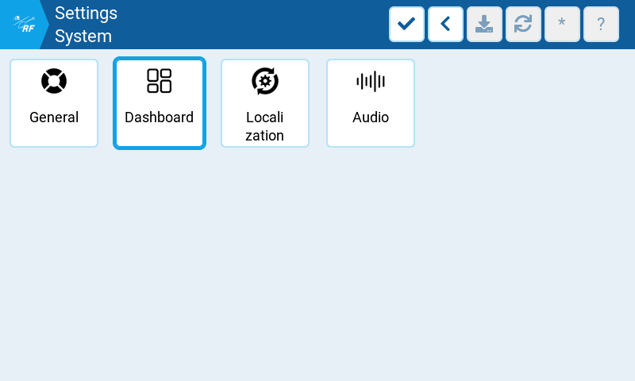
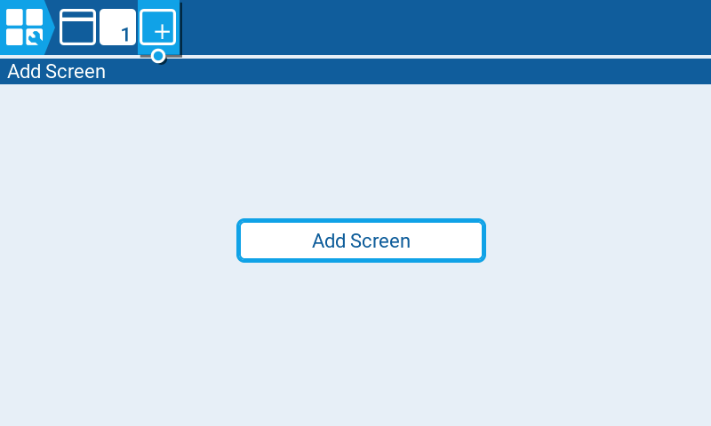
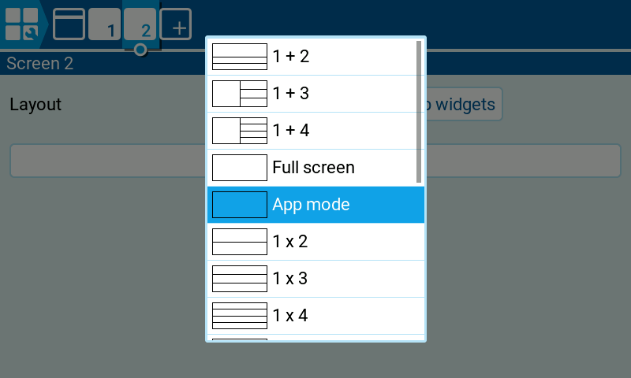
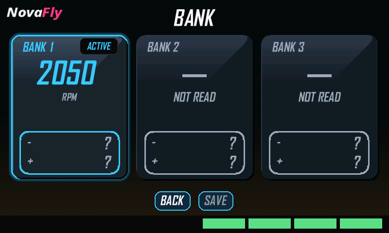

# NovaFly-Theme für das Rotorflight-Dashboard (EdgeTX, TX16S)

[English](README.md) | Deutsch | [Español](README.es.md) | [Français](README.fr.md) | [Italiano](README.it.md) | [Nederlands](README.nl.md)

Das NovaFly-Cockpit als Theme für das Dashboard der Rotorflight Suite für EdgeTX (RFSuite), und ein Schirm dahinter:
BANK, zum Lesen, Stellen und Speichern der Drehzahl der Bank, die du gerade fliegst.

Die Bilder zeigen Sender und RFSuite auf Englisch. Steht der Sender auf Deutsch, zeigt das Theme seine Texte auf
Deutsch.

## Was du brauchst

- RadioMaster TX16S MK3 mit EdgeTX 2.12.5 (das Theme ist für 800 x 480 gezeichnet)
- RFSuite 0.2.2 auf der SD-Karte

## Einbau

1. Nimm das ZIP aus dem Ordner `rfsuite_theme_novafly` dieses Repositorys und entpacke es. Kopiere den Ordner `novafly`
   auf die SD-Karte des Senders:

   `SCRIPTS/RFSUITE/user/dashboard/novafly/`

2. Starte den Sender neu.

3. Drücke **SYS** und starte unter Apps **RFSuite**.

   

4. Öffne **Settings**.

   

5. Öffne **Dashboard**.

   

6. Öffne **Theme**.

   

7. Wähle bei **Theme** den Eintrag **NovaFly**. Speichere mit dem Speichern-Symbol oben.

   

8. Geh zurück zu **Dashboard** und öffne **Settings**.

   

   NovaFly hat hier seine eigene Kachel. Öffne **NovaFly**.

   

   Wähle bei **Colour** die Farbe des Cockpits. Speichere mit dem Speichern-Symbol oben und bestätige mit **Yes**.

   

9. Leg das Widget RFSuite auf einen Bildschirm. Liegt es schon auf einem deiner Bildschirme, überspring diesen Schritt.
   Drücke **TELE**: die Einstellungen der Bildschirme öffnen sich. Drücke oben **+**, dann **Add Screen**.

   

   Wähle bei **Layout** den Eintrag **App mode**.

   

   Drücke **Setup widgets** und dann das leere Feld. Wähle **RFSuite**.

   

Geh zurück zum Bildschirm mit dem Widget RFSuite. Das ist das Cockpit am Boden:

Halte den Finger lang auf den Schirm: das Cockpit geht ins Vollbild. Es sieht gleich aus, aber erst im Vollbild nimmt es
Drücke an. **RTN** lang gedrückt verlässt das Vollbild.

## Das Cockpit

Es ist eine Anzeige. Alle Werte kommen aus der Telemetrie von RFSuite, an RFSuite wird nichts geändert.

Drehzahl auf dem Zifferblatt, Akkuspannung und Ladung, BEC-Spannung, Senderakku, Strom, Temperatur von ESC und MCU,
RT-Last, Funkstrecke (RSSI und VFR), scharf oder nicht scharf, aktive Bank und Rate, Flugtimer und Modellname.

- **Flugtimer.** Die große Uhr ist die Flugzeit von RFSuite. Sie zählt, solange das Modell scharf ist; nach dem
  Entschärfen bleibt die Zeit des letzten Flugs stehen. Die drei Zeilen darunter sind die weiteren Uhren von NovaFly;
  das Theme füllt sie nicht.
- **Akku.** Die Prozentzahl wird aus der Zellenspannung gerechnet: 3,5 V je Zelle sind 0 %, 4,2 V sind 100 %.
- **RT.** Die Echtzeit-Last des FC. Sendet der FC sie nicht, steht dort CPU mit der CPU-Last.
- **VFR.** Bei ELRS steht hinter VFR die Verbindungsgüte (RQly).

Drei Dinge kannst du auf dem Cockpit im Vollbild tun:

- **Farbe.** Am Boden den Kopf oben in der Mitte gedrückt halten. Jedes Halten schaltet mit einem Piep zur nächsten von
  zehn Farben. Die Farbe wird je Modell gemerkt.
- **Schnellmenü.** Ein Druck auf das Feld mit dem Arm-Zustand öffnet das Schnellmenü von RFSuite.
- **BANK.** Ein Druck auf das Feld **BANK | RATE** öffnet den Schirm BANK.

## BANK

Drücke auf dem Cockpit das Feld **BANK | RATE**. BANK liest die Bank, auf der der FC steht.

Die Zahl ist die Drehzahl dieser Bank. Je nach Governor-Modus des FC ist es die Drehzahl in U/min oder das Maximalgas
in %. Dreht der Rotor, steht in der aktiven Bank die Drehzahl von jetzt. Die zwei Zeilen darunter (- und +) füllt das
Theme nicht. Die anderen Bänke zeigen NOT READ, bis du mit dem Bankschalter am Sender auf sie schaltest.

Drücke die aktive Bank. Minus und Plus erscheinen neben der Zahl.

Jeder Druck ändert den Wert um einen Schritt (10 U/min bei der Drehzahl). Ein geänderter Wert ist gelb, und SAVE
wird grün.

Drücke **SAVE**. Das Theme schreibt das Governor-Profil dieser Bank über RFSuite, liest es zurück und vergleicht
es, schreibt es ins EEPROM und liest es noch einmal. Vier grüne Felder und ein Piep heißen: gespeichert und geprüft.

Was BANK nicht tut:

- Es liest und schreibt nicht, solange das Modell scharf ist. Es sagt "Model is armed. Disarm first." und nichts geht
  hinaus.
- Es schreibt nicht, wenn der Arm-Zustand unbekannt ist.
- Es nennt keinen Wert gespeichert, den der FC anders übernommen hat. Das alte Profil geht zurück, und der Schirm sagt
  "Read-back differs. NOT confirmed as saved."

**BACK** oder die Taste **RTN** schließt BANK, und das Cockpit ist wieder da. Fällt die Verbindung zum Heli weg,
schließt BANK von selbst.

## Hinweise

- **Wechsel der Flugphase.** RFSuite baut den Schirm bei jedem Wechsel der Flugphase neu: wenn der Governor aktiv wird
  oder das Gas über 35 % steigt, wenn du nach dem Flug entschärfst, und wenn du danach wieder scharf schaltest. Der
  Schirm ist dabei rund eine Sekunde schwarz. BANK behält, was es gelesen hat.
- **Gas am Sender.** Das Theme stellt nichts an deinem Sender. Fliegst du mit dem Governor im FC, muss das Gas am
  Sender in jeder Bank fest stehen und darf nicht am Pitchknüppel hängen. Wer ein Modell am Sender kopiert, übernimmt
  dessen Gaskurve: voller negativer Pitch kann dann den Motor abschalten.

## Sprachen

Deutsch, Englisch, Spanisch, Französisch, Italienisch und Niederländisch. Das Theme folgt der Sprache des Senders. Die
Wörter sind dieselben wie in NovaFly. Bei jeder anderen Sendersprache ist das Theme englisch.

## Lizenz

GPLv3, wie RFSuite.
