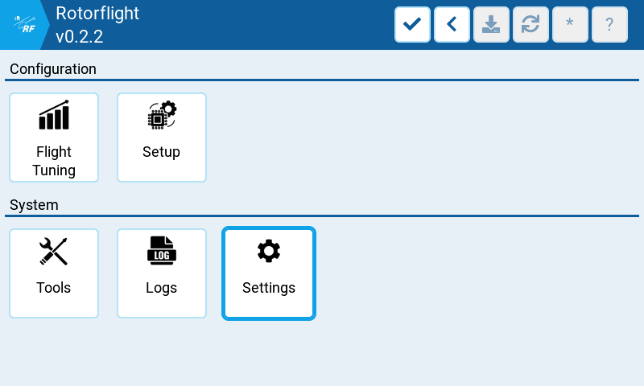
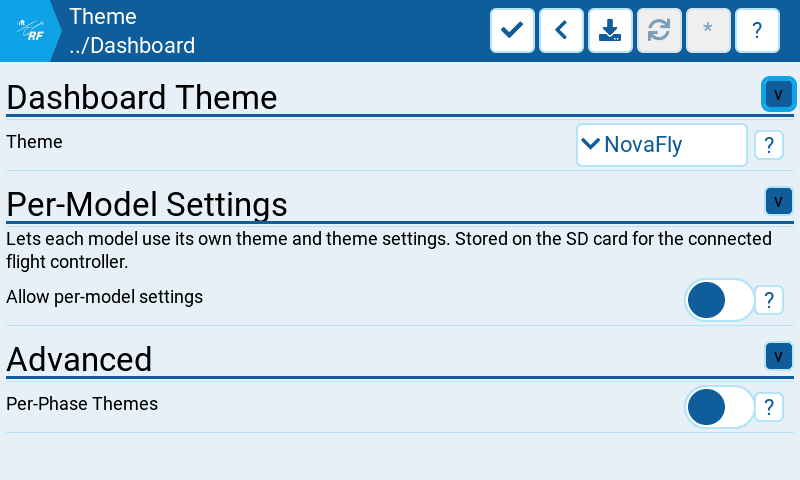
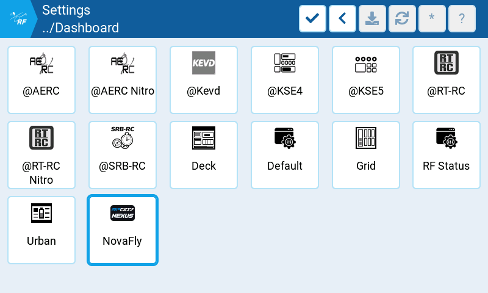
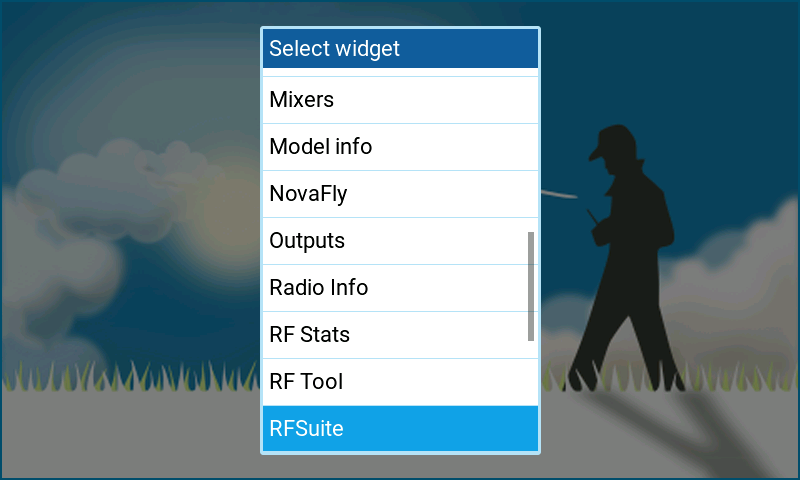
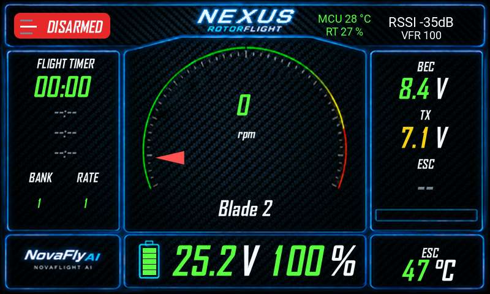
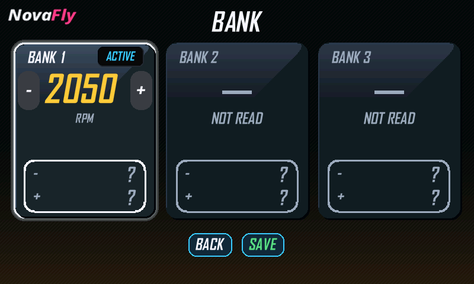

# Thème NovaFly pour le dashboard Rotorflight (EdgeTX, TX16S)

[English](README.md) | [Deutsch](README.de.md) | [Español](README.es.md) | Français | [Italiano](README.it.md) | [Nederlands](README.nl.md)

Le cockpit NovaFly comme thème pour le dashboard de la Rotorflight Suite pour EdgeTX (RFSuite), et un écran derrière :
BANK, pour lire, régler et enregistrer le régime rotor de la banque avec laquelle tu voles.

Les images montrent la radio et RFSuite en anglais. Avec la radio en français, le thème affiche ses textes en français.

## Ce qu'il te faut

- RadioMaster TX16S MK3 avec EdgeTX 2.12.5 (le thème est dessiné pour 800 x 480)
- RFSuite 0.2.2 sur la carte SD

## Installation

1. Prends le ZIP dans le dossier `rfsuite_theme_novafly` de ce dépôt et décompresse-le. Copie le dossier `novafly` sur
   la carte SD de la radio :

   `SCRIPTS/RFSUITE/user/dashboard/novafly/`

2. Redémarre la radio.

3. Appuie sur **SYS** et lance **RFSuite** dans Apps.

   

4. Ouvre **Settings**.

   

5. Ouvre **Dashboard**.

   

6. Ouvre **Theme**.

   

7. Dans **Theme**, choisis **NovaFly**. Enregistre avec le symbole d'enregistrement en haut.

   

8. Reviens à **Dashboard** et ouvre **Settings**.

   

   NovaFly a ici sa propre tuile. Ouvre **NovaFly**.

   

   Dans **Colour**, choisis la couleur du cockpit. Enregistre avec le symbole d'enregistrement en haut et confirme
   avec **Yes**.

   

9. Mets le widget RFSuite sur un écran. S'il est déjà sur l'un de tes écrans, saute cette étape.
   Appuie sur **TELE** : les réglages des écrans s'ouvrent. Appuie sur **+** en haut, puis sur **Add Screen**.

   

   Dans **Layout**, choisis **App mode**.

   

   Appuie sur **Setup widgets**, puis sur le champ vide. Choisis **RFSuite**.

   

Reviens à l'écran avec le widget RFSuite. Voici le cockpit au sol :

Garde le doigt sur l'écran : le cockpit passe en plein écran. Il a le même aspect, mais il n'accepte les appuis qu'en
plein écran. Un appui long sur **RTN** quitte le plein écran.

## Le cockpit

C'est un affichage. Toutes les valeurs viennent de la télémétrie de RFSuite, rien n'est modifié dans RFSuite.

Régime rotor sur le cadran, tension et charge du pack, tension du BEC, batterie de la radio, courant, température de
l'ESC et du MCU, charge RT, liaison (RSSI et VFR), armé ou désarmé, banque et rate actifs, chrono de vol et nom du
modèle.

- **Chrono de vol.** La grande horloge est le temps de vol de RFSuite. Elle compte tant que le modèle est armé ; après
  le désarmement, le temps du dernier vol reste affiché. Les trois lignes en dessous sont les autres horloges de
  NovaFly ; le thème ne les remplit pas.
- **Batterie.** Le pourcentage est calculé à partir de la tension par élément : 3,5 V par élément font 0 %, 4,2 V font
  100 %.
- **RT.** La charge temps réel du FC. Si le FC ne l'envoie pas, on y lit CPU avec la charge CPU.
- **VFR.** Avec ELRS, la qualité de liaison (RQly) se trouve derrière VFR.

Trois choses que tu peux faire sur le cockpit en plein écran :

- **Couleur.** Au sol, maintiens l'en-tête en haut, au milieu. Chaque appui long passe, avec un bip, à la suivante de
  dix couleurs. La couleur est mémorisée par modèle.
- **Menu rapide.** Un appui sur le champ de l'état d'armement ouvre le menu rapide de RFSuite.
- **BANK.** Un appui sur le champ **BANK | RATE** ouvre l'écran BANK.

## BANK

Appuie sur le champ **BANK | RATE** du cockpit. BANK lit la banque sur laquelle se trouve le FC.

Le nombre est le régime rotor de cette banque. Selon le mode governor du FC, c'est le régime en tr/min ou les gaz max
en %. Quand le rotor tourne, la banque active montre le régime de l'instant. Le thème ne remplit pas les deux lignes
en dessous (- et +). Les autres banques indiquent NOT READ jusqu'à ce que tu passes dessus avec l'interrupteur de
banque de la radio.

Appuie sur la banque active. Moins et plus apparaissent à côté du nombre.

Chaque appui change la valeur d'un pas (10 tr/min pour le régime rotor). Une valeur modifiée est jaune, et SAVE
devient vert.

Appuie sur **SAVE**. Le thème écrit le profil governor de cette banque via RFSuite, le relit et le compare,
l'écrit dans l'EEPROM et le lit encore une fois. Quatre champs verts et un bip veulent dire : enregistré et vérifié.

Ce que BANK ne fait pas :

- Il ne lit ni n'écrit tant que le modèle est armé. Il dit "Model is armed. Disarm first." et rien ne part.
- Il n'écrit pas quand l'état d'armement est inconnu.
- Il ne déclare pas enregistrée une valeur que le FC a prise autrement. L'ancien profil revient et l'écran dit
  "Read-back differs. NOT confirmed as saved."

**BACK** ou la touche **RTN** ferme BANK et le cockpit est de nouveau là. Si la liaison avec l'hélico est perdue,
BANK se ferme tout seul.

## Remarques

- **Changement de phase de vol.** RFSuite reconstruit l'écran à chaque changement de phase de vol : quand le governor
  devient actif ou que les gaz dépassent 35 %, quand tu désarmes après le vol, et quand tu réarmes ensuite. L'écran
  reste noir environ une seconde. BANK garde ce qu'il a lu.
- **Gaz sur la radio.** Le thème ne change rien sur ta radio. Si tu voles avec le governor du FC, les gaz de la radio
  doivent être fixes dans chaque banque et ne doivent pas dépendre du manche de pas. Qui copie un modèle sur la radio
  reprend sa courbe de gaz : le pas négatif à fond peut alors couper le moteur.

## Langues

Allemand, anglais, espagnol, français, italien et néerlandais. Le thème suit la langue de la radio. Les mots sont les
mêmes que dans NovaFly. Avec toute autre langue de la radio, le thème est en anglais.

## Licence

GPLv3, comme RFSuite.
