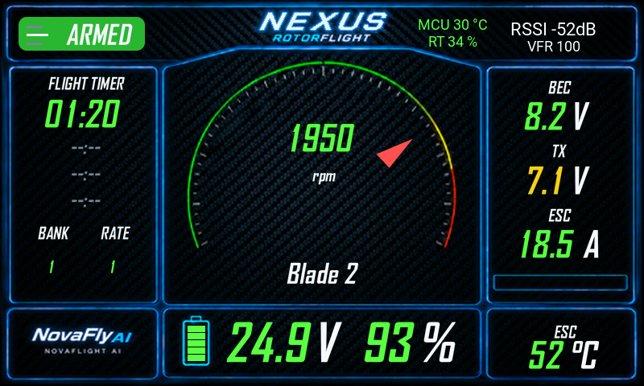
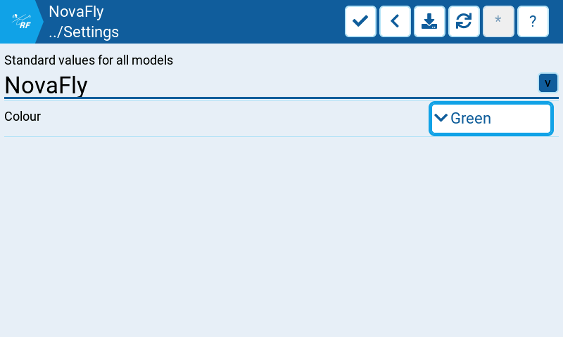
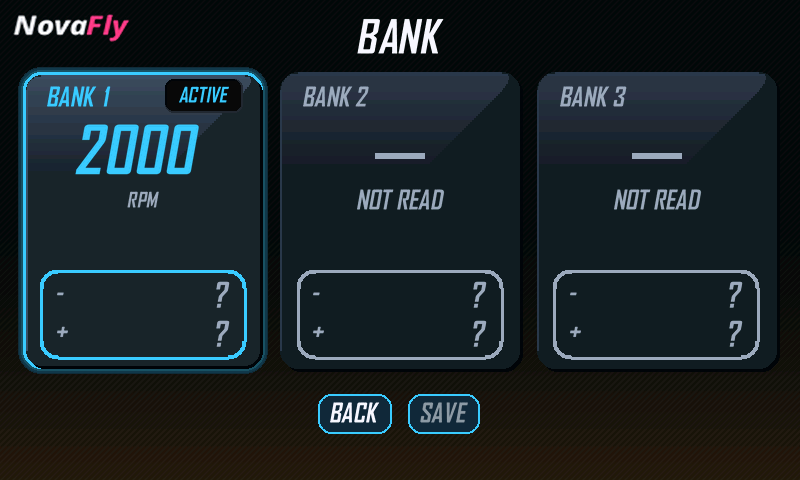
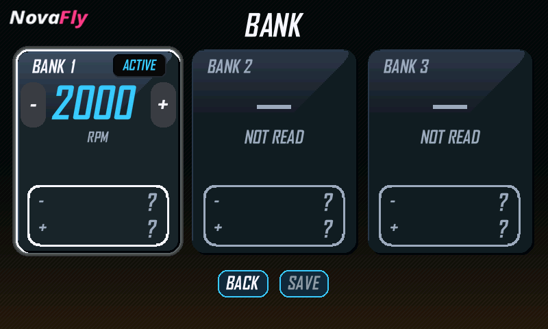

# Tema NovaFly per il dashboard di Rotorflight (EdgeTX, TX16S)

[English](README.md) | [Deutsch](README.de.md) | [Español](README.es.md) | [Français](README.fr.md) | Italiano | [Nederlands](README.nl.md)

Il cockpit di NovaFly come tema per il dashboard della Rotorflight Suite per EdgeTX (RFSuite), e una schermata dietro:
BANK, per leggere, impostare e salvare i giri rotore del banco con cui stai volando.

Le immagini mostrano la radio e RFSuite in inglese. Con la radio in italiano, il tema mostra i suoi testi in italiano.

## Cosa ti serve

- RadioMaster TX16S MK3 con EdgeTX 2.12.5 (il tema è disegnato per 800 x 480)
- RFSuite 0.2.2 sulla scheda SD

## Installazione

1. Prendi lo ZIP dalla cartella `rfsuite_theme_novafly` di questo repository e decomprimilo. Copia la cartella
   `novafly` sulla scheda SD della radio:

   `SCRIPTS/RFSUITE/user/dashboard/novafly/`

2. Riavvia la radio.

3. Premi **SYS** e avvia **RFSuite** in Apps.

   

4. Apri **Settings**.

   

5. Apri **Dashboard**.

   

6. Apri **Theme**.

   

7. In **Theme** scegli **NovaFly**. Salva con il simbolo di salvataggio in alto.

   

8. Torna a **Dashboard** e apri **Settings**.

   

   NovaFly ha qui il suo riquadro. Apri **NovaFly**.

   

   In **Colour** scegli il colore del cockpit. Salva con il simbolo di salvataggio in alto e conferma con **Yes**.

   

9. Metti il widget RFSuite su una schermata. Se è già su una delle tue schermate, salta questo passo.
   Premi **TELE**: si aprono le impostazioni delle schermate. Premi **+** in alto, poi **Add Screen**.

   

   In **Layout** scegli **App mode**.

   

   Premi **Setup widgets** e poi il campo vuoto. Scegli **RFSuite**.

   

Torna alla schermata con il widget RFSuite. Questo è il cockpit a terra:

Tieni il dito sullo schermo: il cockpit passa a schermo intero. Ha lo stesso aspetto, ma solo a schermo intero accetta
le pressioni. Una pressione lunga su **RTN** esce dallo schermo intero.

## Il cockpit

È una visualizzazione. Tutti i valori vengono dalla telemetria di RFSuite, in RFSuite non viene cambiato nulla.

Giri rotore sul quadrante, tensione e carica del pacco, tensione del BEC, batteria della radio, corrente, temperatura
dell'ESC e della MCU, carico RT, collegamento (RSSI e VFR), armato o disarmato, banco e rate attivi, timer di volo e
nome del modello.

- **Timer di volo.** L'orologio grande è il tempo di volo di RFSuite. Conta finché il modello è armato; dopo il
  disarmo resta il tempo dell'ultimo volo. Le tre righe sotto sono gli altri orologi di NovaFly; il tema non le
  riempie.
- **Batteria.** La percentuale è calcolata dalla tensione per cella: 3,5 V per cella sono 0 %, 4,2 V sono 100 %.
- **RT.** Il carico in tempo reale dell'FC. Se l'FC non lo invia, lì c'è CPU con il carico della CPU.
- **VFR.** Con ELRS, dietro VFR c'è la qualità del collegamento (RQly).

Tre cose che puoi fare sul cockpit a schermo intero:

- **Colore.** A terra, tieni premuta l'intestazione in alto, al centro. Ogni pressione lunga passa, con un bip, al
  successivo di dieci colori. Il colore viene ricordato per modello.
- **Menu rapido.** Una pressione sul campo dello stato di armamento apre il menu rapido di RFSuite.
- **BANK.** Una pressione sul campo **BANK | RATE** apre la schermata BANK.

## BANK

Premi il campo **BANK | RATE** sul cockpit. BANK legge il banco su cui si trova l'FC.

Il numero sono i giri rotore di quel banco. A seconda della modalità governor dell'FC sono i giri in rpm oppure il gas
massimo in %. Quando il rotore gira, il banco attivo mostra i giri di quel momento. Il tema non riempie le due righe
sotto (- e +). Gli altri banchi dicono NOT READ finché non passi a loro con l'interruttore dei banchi sulla radio.

Premi il banco attivo. Meno e più compaiono accanto al numero.

Ogni pressione cambia il valore di un passo (10 rpm per i giri rotore). Un valore cambiato è giallo, e SAVE
diventa verde.

Premi **SAVE**. Il tema scrive il profilo governor di quel banco tramite RFSuite, lo rilegge e lo confronta, lo
scrive nella EEPROM e lo legge ancora una volta. Quattro campi verdi e un bip significano: salvato e verificato.

Cosa BANK non fa:

- Non legge né scrive finché il modello è armato. Dice "Model is armed. Disarm first." e non esce nulla.
- Non scrive quando lo stato di armamento è sconosciuto.
- Non dichiara salvato un valore che l'FC ha preso in modo diverso. Torna il vecchio profilo e la schermata dice
  "Read-back differs. NOT confirmed as saved."

**BACK** o il tasto **RTN** chiude BANK e il cockpit è di nuovo lì. Se il collegamento con l'elicottero si perde,
BANK si chiude da solo.

## Note

- **Cambio della fase di volo.** RFSuite ricostruisce la schermata a ogni cambio della fase di volo: quando il
  governor diventa attivo o il gas sale sopra il 35 %, quando disarmi dopo il volo e quando poi armi di nuovo. Lo
  schermo resta nero per circa un secondo. BANK conserva ciò che ha letto.
- **Gas sulla radio.** Il tema non cambia nulla sulla tua radio. Se voli con il governor dell'FC, il gas sulla radio
  deve essere fisso in ogni banco e non deve dipendere dallo stick del passo. Chi copia un modello sulla radio si
  porta dietro la sua curva del gas: il passo negativo a fondo corsa può allora spegnere il motore.

## Lingue

Tedesco, inglese, spagnolo, francese, italiano e olandese. Il tema segue la lingua della radio. Le parole sono le
stesse di NovaFly. Con qualsiasi altra lingua della radio il tema è in inglese.

## Licenza

GPLv3, come RFSuite.
