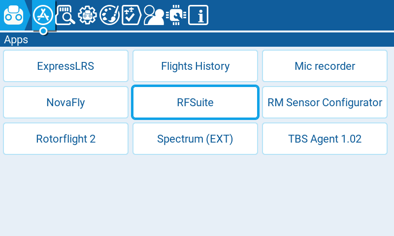

# NovaFly-thema voor het Rotorflight-dashboard (EdgeTX, TX16S)

[English](README.md) | [Deutsch](README.de.md) | [Español](README.es.md) | [Français](README.fr.md) | [Italiano](README.it.md) | Nederlands

De NovaFly-cockpit als thema voor het dashboard van de Rotorflight Suite voor EdgeTX (RFSuite), en één scherm erachter:
BANK, om het toerental van de bank waarmee je vliegt te lezen, in te stellen en op te slaan.

De afbeeldingen tonen de zender en RFSuite in het Engels. Staat de zender op Nederlands, dan toont het thema zijn
teksten in het Nederlands.

## Wat je nodig hebt

- RadioMaster TX16S MK3 met EdgeTX 2.12.5 (het thema is getekend voor 800 x 480)
- RFSuite 0.2.2 op de SD-kaart

## Installeren

1. Neem de ZIP uit de map `rfsuite_theme_novafly` van deze repository en pak hem uit. Kopieer de map `novafly` naar de
   SD-kaart van de zender:

   `SCRIPTS/RFSUITE/user/dashboard/novafly/`

2. Start de zender opnieuw.

3. Druk op **SYS** en start **RFSuite** onder Apps.

   

4. Open **Settings**.

   

5. Open **Dashboard**.

   

6. Open **Theme**.

   

7. Kies bij **Theme** de regel **NovaFly**. Sla op met het opslaan-symbool bovenaan.

   

8. Ga terug naar **Dashboard** en open **Settings**.

   

   NovaFly heeft hier een eigen tegel. Open **NovaFly**.

   

   Kies bij **Colour** de kleur van de cockpit. Sla op met het opslaan-symbool bovenaan en bevestig met **Yes**.

   

9. Zet de widget RFSuite op een scherm. Staat hij al op een van je schermen, sla deze stap dan over.
   Druk op **TELE**: de instellingen van de schermen gaan open. Druk bovenaan op **+** en dan op **Add Screen**.

   

   Kies bij **Layout** de regel **App mode**.

   

   Druk op **Setup widgets** en dan op het lege veld. Kies **RFSuite**.

   

Ga terug naar het scherm met de widget RFSuite. Dit is de cockpit op de grond:

Houd je vinger lang op het scherm: de cockpit gaat naar volledig scherm. Hij ziet er hetzelfde uit, maar pas in
volledig scherm neemt hij drukken aan. **RTN** lang indrukken verlaat het volledige scherm.

## De cockpit

Het is een weergave. Alle waarden komen uit de telemetrie van RFSuite, in RFSuite wordt niets gewijzigd.

Toerental op de wijzerplaat, accuspanning en lading, BEC-spanning, zenderaccu, stroom, temperatuur van ESC en MCU,
RT-belasting, verbinding (RSSI en VFR), armed of disarmed, actieve bank en rate, vluchttimer en modelnaam.

- **Vluchttimer.** De grote klok is de vliegtijd van RFSuite. Hij telt zolang het model armed is; na het disarmen
  blijft de tijd van de laatste vlucht staan. De drie regels eronder zijn de andere klokken van NovaFly; het thema
  vult ze niet.
- **Accu.** Het percentage wordt berekend uit de celspanning: 3,5 V per cel is 0 %, 4,2 V is 100 %.
- **RT.** De realtime-belasting van de FC. Stuurt de FC die niet, dan staat er CPU met de CPU-belasting.
- **VFR.** Bij ELRS staat achter VFR de verbindingskwaliteit (RQly).

Drie dingen kun je op de cockpit in volledig scherm doen:

- **Kleur.** Op de grond de kop bovenaan in het midden ingedrukt houden. Elke keer vasthouden schakelt met een piep
  naar de volgende van tien kleuren. De kleur wordt per model onthouden.
- **Snelmenu.** Een druk op het veld met de arm-status opent het snelmenu van RFSuite.
- **BANK.** Een druk op het veld **BANK | RATE** opent het scherm BANK.

## BANK

Druk op het veld **BANK | RATE** op de cockpit. BANK leest de bank waarop de FC staat.

Het getal is het toerental van die bank. Afhankelijk van de governor-modus van de FC is het het toerental in rpm of
het maximale gas in %. Draait de rotor, dan toont de actieve bank het toerental van dat moment. Het thema vult de twee
regels eronder (- en +) niet. De andere banken zeggen NOT READ tot je er met de bankschakelaar op de zender naar
overschakelt.

Druk op de actieve bank. Min en plus verschijnen naast het getal.

Elke druk verandert de waarde met één stap (10 rpm voor het toerental). Een gewijzigde waarde is geel, en SAVE
wordt groen.

Druk op **SAVE**. Het thema schrijft het governor-profiel van die bank via RFSuite, leest het terug en vergelijkt
het, schrijft het naar de EEPROM en leest het nog een keer. Vier groene velden en een piep betekenen: opgeslagen en
gecontroleerd.

Wat BANK niet doet:

- Het leest en schrijft niet zolang het model armed is. Het zegt "Model is armed. Disarm first." en er gaat niets
  uit.
- Het schrijft niet wanneer de arm-status onbekend is.
- Het noemt geen waarde opgeslagen die de FC anders heeft overgenomen. Het oude profiel gaat terug en het scherm zegt
  "Read-back differs. NOT confirmed as saved."

**BACK** of de toets **RTN** sluit BANK en de cockpit is er weer. Valt de verbinding met de heli weg, dan sluit
BANK vanzelf.

## Opmerkingen

- **Wissel van vluchtfase.** RFSuite bouwt het scherm bij elke wissel van vluchtfase opnieuw op: wanneer de governor
  actief wordt of het gas boven 35 % komt, wanneer je na de vlucht disarmt, en wanneer je daarna weer armt. Het scherm
  is daarbij ongeveer een seconde zwart. BANK behoudt wat het gelezen heeft.
- **Gas op de zender.** Het thema verandert niets aan je zender. Vlieg je met de governor in de FC, dan moet het gas
  op de zender in elke bank vast staan en mag het niet aan de pitchknuppel hangen. Wie een model op de zender kopieert,
  neemt de gascurve ervan mee: volle negatieve pitch kan dan de motor uitschakelen.

## Talen

Duits, Engels, Spaans, Frans, Italiaans en Nederlands. Het thema volgt de taal van de zender. De woorden zijn dezelfde
als in NovaFly. Bij elke andere zendertaal is het thema Engels.

## Licentie

GPLv3, net als RFSuite.
